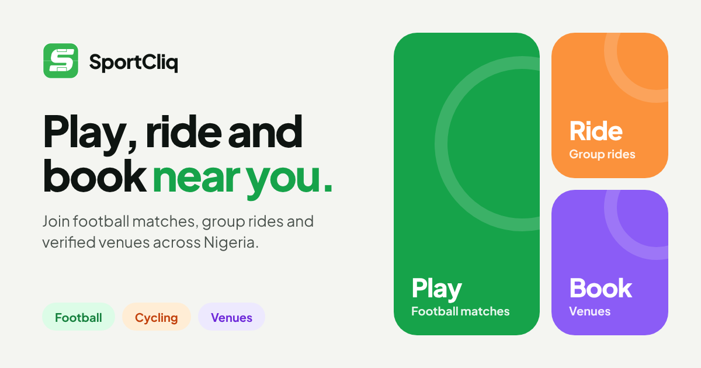

<p align="center">
  
</p>

<h1 align="center">SportCliq</h1>

<p align="center">
  Play football, join group rides and book sports venues near you in Nigeria.<br />
  <a href="https://app.sportcliq.com"><b>app.sportcliq.com</b></a>
</p>

<p align="center">
  
</p>

---

## What it does

| For | Features |
| --- | --- |
| **Players** | Find matches near you, join free or paid games, save a QR ticket, see your stats and badges |
| **Organisers** | Create a match in 4 steps, check players in by scanning QR codes, split teams, sell spectator tickets, cash out |
| **Riders and hosts** | Join or host group rides from landmarks, rentals and registration deadlines, QR check-in |
| **Venue owners** | List a venue, take hourly bookings with access codes, check customers in, track revenue and cash out |

Plus: location aware lists (by state), a short first run tour, skeleton loading, installable PWA and push alerts.

## Tech

- **App:** React 18, TypeScript, Vite, Tailwind CSS, shadcn/ui, React Query
- **Backend:** Supabase (Postgres, Auth, Edge Functions, RLS)
- **Payments:** Paystack
- **Push:** OneSignal, sharing the app service worker
- **PWA:** vite-plugin-pwa (Workbox)
- **Hosting:** Vercel

## Getting started

```bash
npm install
npm run dev        # http://localhost:8080
npm run build      # production build in dist/
npm run preview    # serve the build locally
```

Supabase settings live in `src/integrations/supabase/client.ts`. Edge functions are in `supabase/functions`.

## Project layout

```
src/
  pages/            screens, grouped by area (match, cycling, venueManagement, profile, gameManagement)
  components/
    sc/             SportCliq design kit: ui, skeletons, location, onboarding, QR scanner, ticket card
    ui/             shadcn primitives, restyled to the design tokens
  lib/location.ts   state detection (runs on device, only the state name is stored)
public/
  brand/            logo files
  icons/            PWA icons (any and maskable)
  llms.txt          summary for AI assistants
  sitemap.xml, robots.txt, og-image.png
```

## Design system

Light mode only. Font is **Satoshi** (Fontshare) with Plus Jakarta Sans as fallback.

| Token | Value | Use |
| --- | --- | --- |
| `sc-green` | `#16A34A` | Primary actions, white text on top |
| `sc-ink` | `#0E1411` | Text, dark buttons, active tab |
| `sc-bg` | `#F4F5F1` | App background |
| Football | `#DCFCE7` / `#15803D` / `#16A34A` | bg / text / fill |
| Cycling | `#FFEDD5` / `#C2410C` / `#FB923C` | bg / text / fill |
| Venues | `#EDE9FE` / `#6D28D9` / `#8B5CF6` | bg / text / fill |

Shared building blocks are in `src/components/sc/ui.tsx`. Prefer them over one off styles.

## SEO and discovery

- Per page title, description, canonical and Open Graph tags through `src/components/Seo.tsx`
- schema.org data for the site, matches (`SportsEvent`), rides and venues (`SportsActivityLocation`)
- `public/llms.txt` and `public/llms-full.txt` for AI assistants, `sitemap.xml` and `robots.txt`

## License

© SportCliq. All rights reserved. Proprietary and confidential.

Support: support@sportcliq.com
